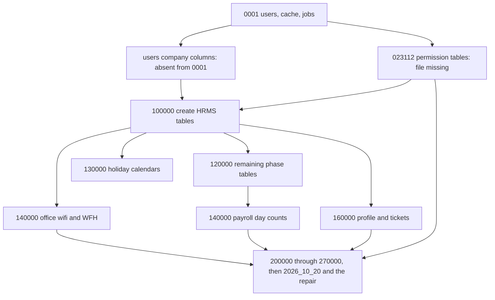

# Fresh-install dependency graph

Filename order is what Laravel sorts. It does not satisfy a missing column or a missing file. This graph was not executed.

`permission` does not create `users.tenant_id`. It is on the path because the dump records it before `100000`, and because `230000` only creates `role_assignment_events` when `roles` exists. `wifi` and `days` share a timestamp. Filename order and dump batches 4 and 5 place wifi first. `days` depends on `payroll_items` from `120000`, not on `wfh_requests`.

## Ordered checklist

1. Stock `0001` users, cache, and jobs. These files exist. Unqualified strings use length 191 because the provider boot setting is in place. Explicit lengths are unchanged. The users table still lacks the five company columns.
2. Users company columns. Not in `0001`. The Stage 52 candidate is quarantined. `100000` cannot add `users_tenant_id_foreign` without `tenant_id`.
3. Permission migration `2026_10_19_023112_create_permission_tables`. The file is missing. Spatie is not a Meetara dependency. Options are undecided.
4. `2026_10_19_100000_create_hrms_tables`. Payload is quarantined. It creates `tenants` and then the users foreign key. It is the source of the tables the later historical files alter.
5. `2026_10_19_120000_create_remaining_phase_tables`. Payload is quarantined. Depends on `100000`. Also updates `plan_feature` without a reversing `down()`.
6. `2026_10_19_130000_add_holiday_calendars`. Payload is quarantined. Depends on `holidays` and `employees` from `100000`.
7. `2026_10_19_140000_add_office_wifi_and_wfh`. Payload is quarantined. Depends on `100000`. Runs before the other `140000` file by filename and by dump batch.
8. `2026_10_19_140000_add_payroll_day_counts`. Payload is quarantined. Depends on `payroll_items` from `120000`.
9. `2026_10_19_160000_add_profile_details_and_tickets`. Payload is quarantined. Creates tickets pointing at `employees`. The dump points `assignee_id` at `users` only after on-disk `260000`.
10. On-disk `2026_10_19_200000` through `2026_10_19_270000`. These files exist. They alter or create follow-on tables only when the historical tables already exist. If those tables are absent, they return without building them.
11. On-disk `2026_10_20_120000`, `140000`, `160000`, `180000`, `200000`, and `2026_10_21_120000`. These are outside the 18-row dump. Invitation and the subject-email repair return without throwing when `2026_10_20_120000` is already recorded and `company_lifecycle_events` was not created. That return is not limited to SQLite in the source. This path was not run.

## First failure and downstream blockers

The first failure is step 2 together with step 3, immediately after the three `0001` files. The historical ledger's next name is the missing permission migration. Independently, `users.tenant_id` does not exist, so step 4 cannot succeed.

Downstream blockers:

- Steps 5 through 9 have no active files. Their payloads stay quarantined.
- Step 4 is unreachable until the users columns exist, even if its payload is later approved.
- Step 8 is unreachable until step 5 has created `payroll_items`.
- Step 10 can be recorded on an empty historical schema and still not match the dump.
- Step 11 is not part of the 18-row dump. The dump also has no `company_lifecycle_events`, `company_admin_invitations`, `offer_letters`, or `employee_record_events`.
- The string-length restoration does not remove any of these blockers.

No step from 2 onward is authorized.
